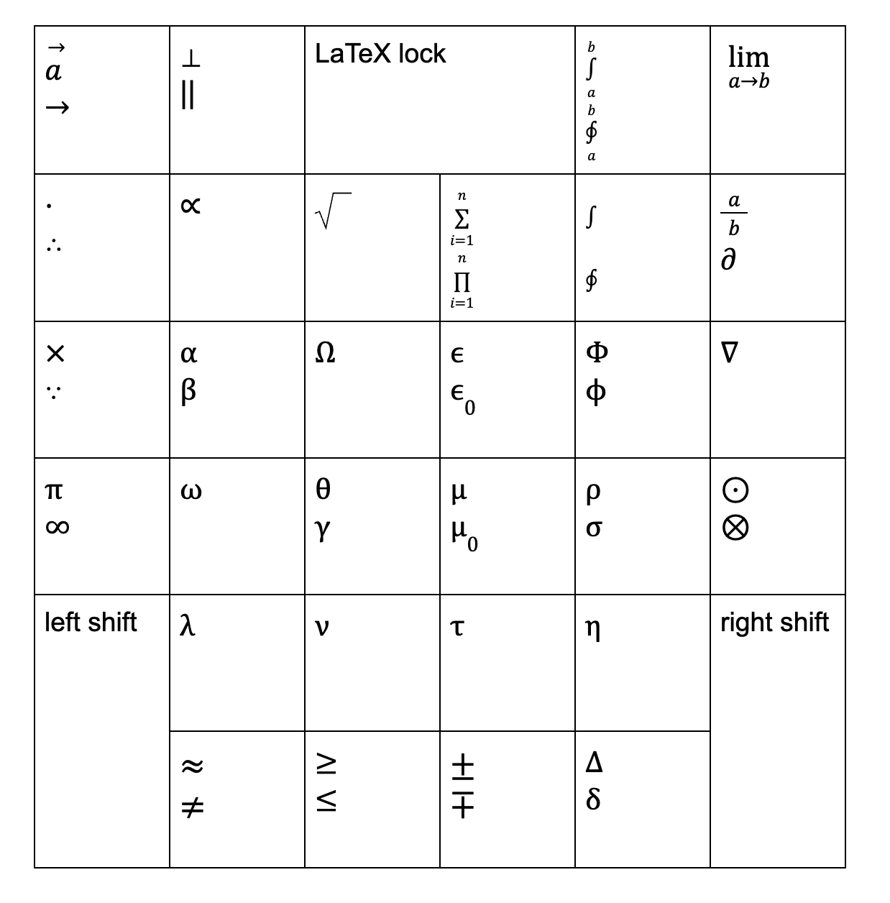

# physics-keyboard

A 33-key mechanical keyboard for writing physics and math.

## Features
- Greek letter input
- Math symbol input
- Left and right shift keys allow for 53 unique characters
- Caps Lock-like key allows switching between LaTeX and plain unicode output
- Compact square shape; similar in size to a large numpad/macropad

[BOM](bom.csv)

## Tools
- PCB design: KiCad, marbastlib
- Enclosure CAD: OnShape
- Keycap lettering: Tinkercad
- Firmware: QMK

## Firmware
WinCompose is required for unicode input on Windows. For Mac or Linux, change UNICODE_SELECTED_MODES in config.h. Copy [this folder](firmware/physics_keyboard) into your keyboards directory after setting up QMK, then buildand flash the firmware. [QMK docs](https://docs.qmk.fm/newbs_getting_started)

## Motivation
In our last years of high school, we wrote several lab reports in IB Physics which required us to input mathematical equations. We built this keyboard to make that process easier, in our classes in university.

## What we learned
Before this project, we wrote our formulae in the Google Docs equation editor. This project helped us learn LaTeX, a faster and more advanced tool than what we used previously. We also learned PCB design, including best practices for routing and design rule checking.

